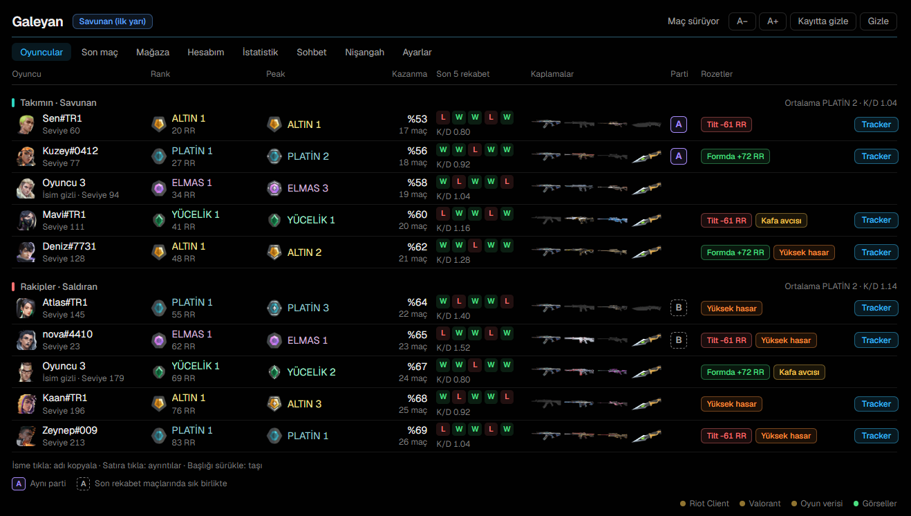
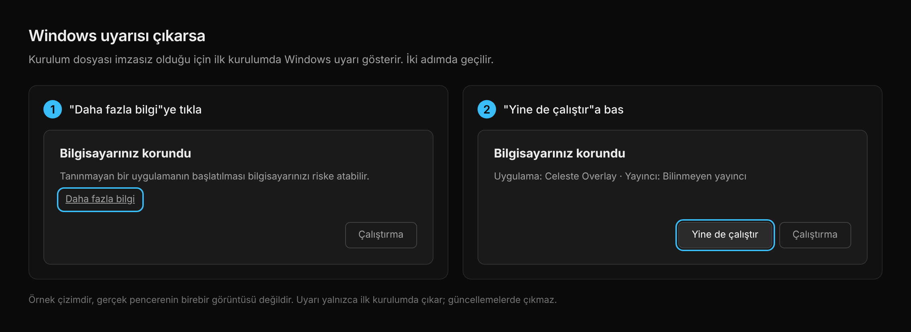

# Celeste Overlay

Valorant lobisinde herkesin rankını, son maçlarını ve kaplamalarını tek bakışta gösteren, sade ve karanlık temalı bir overlay. Giriş yapmaz, oyuna dokunmaz, ne yaptığını canlı gösterir.



## Güvenlik

- **Giriş yok.** Riot hesabına giriş yapmazsın. Uygulama, açık Riot Client oturumunu okur.
- **Yalnızca okur.** Oyuna tuş göndermez, oyun belleğine girmez, oyun dosyalarını değiştirmez. Hile değildir.
- **Veriler sende kalır.** Etiketler, notlar ve ayarlar yalnızca bu bilgisayarda saklanır. Uygulama yalnızca kaç kişinin kullandığını saymak için rastgele bir kimlik ve sürüm numarası gönderir (oyuncu adları ve maç bilgisi gönderilmez). **Öneri / Hata bildir** formunu gönderirsen yazdığın metin, Riot ID'n, yazdıysan Discord adın ve istersen tanı bilgisi Celeste yetkililerine gider. Bu istekler de S.S.S & Panel'deki canlı kayıtta görünür.
- **Gizli isimler gizli kalır.** İsmini gizleyen oyuncunun adı sorgulanmaz, saklanmaz, gösterilmez.
- **Kanıtı uygulamanın içinde.** **S.S.S & Panel** sekmesi, uygulamanın attığı her isteği canlı listeler.
- Kaynak kodu bu depoda açıktır.

Celeste Overlay, Riot Games ile bağlantılı değildir ve Riot Games tarafından onaylanmamıştır. Riot Games, üçüncü taraf uygulamaları onaylamaz ve Vanguard'ın bir uygulamayı şimdi ya da ileride işaretlemeyeceğini garanti etmez ([hizmet şartları](https://www.riotgames.com/tr/terms-of-service-TR)). Bu uygulama için de garanti verilemez; yapılabilecek tek şey ne yaptığını açıkça göstermektir.

## Kurulum

1. [Releases](../../releases/latest) sayfasından `…-setup.exe` dosyasını indir.
2. Dosyayı çalıştır. Windows bir uyarı gösterebilir, aşağıya bak.
3. Riot Client'ı aç ve giriş yap, sonra Valorant'ı başlat.
4. Valorant'ta **Ayarlar → Video → Ekran Modu**'nu **Pencereli Tam Ekran** yap. Tam ekran modunda overlay oyunun arkasında kalır ve görünmez.
5. Ajan seçimi başlayınca oyuncular overlay'de kendiliğinden listelenir.

İlk açılışta uygulama kısa bir rehber gösterir. Rehberi Ayarlar → Hakkında bölümünden tekrar açabilirsin.

### Windows "SmartScreen" uyarısı

İlk kurulumda **"Windows bilgisayarınızı korudu"** uyarısı çıkabilir. Sebep virüs değil, kurulum dosyasının ücretli bir kod imzalama sertifikasıyla imzalanmamış olmasıdır. Windows imzasız ve yeni dosyaların hepsinde bu uyarıyı gösterir.

1. Uyarıda **Daha fazla bilgi**'ye tıkla.
2. **Yine de çalıştır** düğmesine bas.



Uyarı yalnızca ilk kurulumda çıkar. Uygulama içi güncellemelerde çıkmaz. Kurulum dosyasını yalnızca bu deponun [Releases](../../releases) sayfasından indir.

## Özellikler

### Oyuncular (lobi)

Ajan seçiminde ve maç sırasında herkes tek tabloda:

- **Rank, peak ve RR.** Güncel rank ile en yüksek rank yan yana.
- **Kazanma oranı** ve maç sayısı.
- **Son maçlar.** Son 5 maçın W/L işareti. Rekabet düz, diğer modlar kesikli çerçeveyle görünür. Üstüne gelince mod, harita, ajan ve K/D/A çıkar.
- **Kaplamalar.** Silah başına kaplama görselleri. Görselin altındaki renkli çizgi kaplamanın nadirliğini gösterir (Select, Deluxe, Premium, Ultra, Exclusive); en nadir üçü ayrıca hafifçe parlar.
- **Parti.** Aynı partideki oyuncular aynı harfi alır (A, B…). Kesin bilinmeyenler soluk harfle gösterilir.
- **Rozetler.** Yalnızca son rekabet maçlarında ölçülen değerlere göre: Kafa avcısı, Yüksek hasar, Öncü, İlk ölen, Düşük HS, Formda, Düşüşte.
- **Takım karşılaştırması.** Her takımın ortalama ranki ve K/D'si.
- **Tekrar karşılaşma.** Daha önce aynı maçta olduğun oyuncular "3. kez" etiketiyle öne çıkar ve geçen sefer takım mı rakip mi olduğu yazılır. İsimleri yalnızca lobide zaten görünüyorsa saklanır.
- **Oyuncu ayrıntısı.** Satıra tıklayınca: maç geçmişi (mod filtresiyle: rekabet, derecesiz, tam gaz, diğer; her maçta tarih, saat ve kaç dakika önce oynandığı), oynayış istatistikleri, kullandığı kaplamalar.
- **Geçmiş sekmesi.** Oyuncunun bu haritadaki ve bu ajandaki rekabet performansı (maç, galibiyet, K/D), en çok oynadığı roller ve ajanlar (son 25 maçın içinden, rekabet maçları), tek ajan oyuncusu etiketi, liderlik tablosu sırası ve açılıp kapanan **Geçmiş actler** listesi (her actte act sonu rank'ı, en yüksek rank, galibiyet). "Kayıtlı ilk rekabet acti" Riot'un kayıtlarındaki en eski rekabet actidir, hesabın açılış tarihi değildir. Riot oyun süresi, toplam saat ya da tracker skoru vermez, bunlar gösterilmez. Oyuncuya etiket ve not eklenebilir.
- **İsim kopyalama.** İsme tıkla, adı kopyalanır. Tracker düğmesi oyuncuyu tarayıcıda açar.

### Son maç

Biten maçın raporu kendiliğinden açılır: skor, oyuncu tablosu (K/D/A, ACS, kafa isabeti, hasar, ilk kan) ve kimin kimi kaç kez öldürdüğü. Bir oyuncuya tıklayınca etiket koyabilir (İyi, Toksik, Şüpheli) ve tracker.gg profilini tarayıcıda açabilirsin. İsmi gizli oyuncuya etiket konur ama profil bağlantısı yoktur.

### Mağaza

Günlük ve gece mağazan, kaplama görselleri ve fiyatlarla. Oyun kapalıyken de çalışır, Riot Client açık olması yeterli.

### Hesabım

Bakiye (VP, RP, KC), günlük ve haftalık görevler, battle pass ilerlemesi ve envanter.

### İstatistik

Kendi rekabet verilerin: son maçlar, kazanma oranı, ajan bazında performans, RR değişimi.

### Sohbet

Hızlı mesajlar: sık yazdığın mesajları ekle, listeden birine tıklayınca panoya kopyalanır. Oyunda sohbeti açıp Ctrl+V ile yapıştırırsın. Oyuna tuş göndermez.

### Nişangah

8 hazır nişangah, görselleriyle. Karta tıklayınca kod kopyalanır; oyunda Ayarlar → Nişangah → İçe aktar ile yapıştırırsın.

### S.S.S & Panel

Panelin üst yarısı sık sorulan soruları kısaca cevaplar: neden güvenmeli, ban riski, şifre, oyuna dokunma, hile, gizli isimler, veri, Windows uyarısı. Alt yarısı bunları doğrulayan **canlı kayıttır**:

- Her isteğin saati, ne için atıldığı, durum kodu ve süresi
- Toplam istek, son dakikadaki istek, okuma / sorgu / **yazma** sayacı. Yazma sayacı Riot'ta bir şey değiştiren istekleri sayar ve sıfır kalmalıdır.
- Hangi adreslere bağlandığı (Riot sunucuları, bu bilgisayar, valorant-api.com, GitHub, Celeste'nin anonim sayımı). Beklenmeyen bir adres kırmızı görünür.
- İsmi gizli olduğu için sorgulanmayan oyuncu sayısı
- Bilgisayarda saklanan veriler ve **Verilerimi sil** düğmesi
- Akışı tek tuşla kopyalama

Kayıt yalnızca bellekte tutulur. Token, çerez ve istek gövdesi hiç kaydedilmez, oyuncu ve maç kimlikleri maskelenir.

### Tilt koruyucu

Zor bir seansta sakin bir hatırlatma gösterir. Yalnızca kendi rekabet maçlarına bakar; hiçbir şey göndermez.

- Üst üste kayıp (varsayılan 3 maç)
- Seanstaki RR kaybı (varsayılan −40 RR)
- Oyun süresi (varsayılan 3 saat)

Seans, aralarında 100 dakikadan uzun ara olmayan maçlardır. Oyuncular sekmesinde "Bu seans · 1G 4M · −52 RR · 2 sa 28 dk" satırı görünür. Eşikler Ayarlar'dan değiştirilir ya da tamamen kapatılır.

### Ayarlar

- Vurgu rengi, saydamlık, yazı boyutu (%80–%150)
- Hangi sütunların görüneceği, overlay genişliği buna göre ayarlanır
- Rozet eşikleri
- Saldıran / savunan yönü
- **FPS modu:** oyunda FPS düşüşü yaşarsan aç. Animasyonlar ve geçiş efektleri kapanır, overlay maç başlayınca en geç 5 saniyede gizlenir, gizliyken arka plandaki denetimler seyrekleşir. Gösterilen bilgiler değişmez.
- Otomatik gizleme: maç başlayınca overlay kendini gizler, ajan seçiminde geri gelir
- Tilt koruyucu eşikleri
- Güncelleme denetimi, rehberi yeniden göster, tanı bilgisini kopyala

### Genel

- **F2:** Overlay'i gösterir veya gizler.
- **Bulanıklaştır:** Oyuncu isimleri bulanık görünür. Video çekerken başkalarının kimliğini göstermemek için. Kopyalama çalışır ama bildirimde isim yazmaz.
- **Kayıtta gizle:** Overlay ekran kaydında ve yayında görünmez, sen oyunda görmeye devam edersin (Windows).
- **Fare otomatik:** İmleç overlay'in üstündeyken tıklamalar overlay'e, dışındayken oyuna gider.
- **Kendiliğinden güncelleme:** Yeni sürüm çıkınca uygulama haber verir, kurulum senin onayınla başlar.
- Tepsi simgesi: göster/gizle, konumu sıfırla, çıkış.
- **Öneri / Hata bildir:** Alt şeritteki düğme uygulamanın içinde bir form açar: türü seç (öneri ya da hata), yaz ve gönder. Doğrudan Celeste yetkililerinin kanalına düşer; Riot ID'n de eklenir, form bunu gönderirken açıkça söyler. Hata bildiriminde tanı bilgisi isteğe bağlı eklenir.

Rekabet verileri (son 5 maç, kafa isabeti, K/D, rozetler) yalnızca **rekabet** maçlarından hesaplanır.

## Sorun giderme

**Overlay oyunda görünmüyor:** Valorant'ın Ekran Modu Pencereli Tam Ekran olmalı. Tam ekranda overlay oyunun arkasında kalır.

Alt köşedeki noktalara tıklayınca neyin çalışmadığını görürsün. Sorun bildirirken Ayarlar → Hakkında → **Tanı bilgisini kopyala** çıktısını ekle. Kişisel kimlikler bu çıktıdan temizlenir. S.S.S & Panel sekmesindeki **Kopyala** düğmesi ağ kaydını da aynı şekilde paylaşılabilir hâle getirir.

## Geliştirme

Gereksinimler: Node.js, Rust, [Tauri 2 ön koşulları](https://tauri.app/start/prerequisites/).

```
npm install
npm run tauri dev
```

Yapı:

| Klasör | İçerik |
|---|---|
| `src/` | Arayüz (React + TypeScript) |
| `riot-core/` | Riot Client ve oyun verisi katmanı (Rust). Tüm istekler `netlog` üzerinden geçer. |
| `src-tauri/` | Masaüstü kabuğu (Tauri 2): pencere, tepsi, F2, güncelleyici |

Testler: `cd riot-core && cargo test`

Sürüm çıkarmak için `package.json`, `src-tauri/Cargo.toml` ve `src-tauri/tauri.conf.json` içindeki sürüm aynı olmalı, sonra `vX.Y.Z` etiketi gönderilir. GitHub Actions kurulum dosyasını ve `latest.json` güncelleme dosyasını yayınlar.

---

Made by Claude & [bneceleste](https://www.instagram.com/bneceleste)
